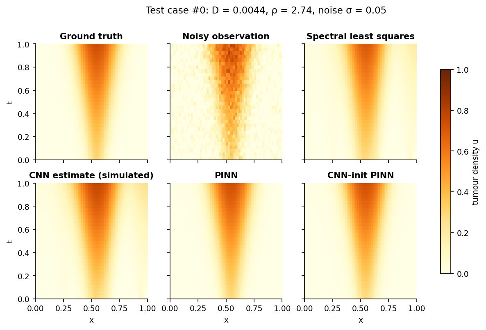
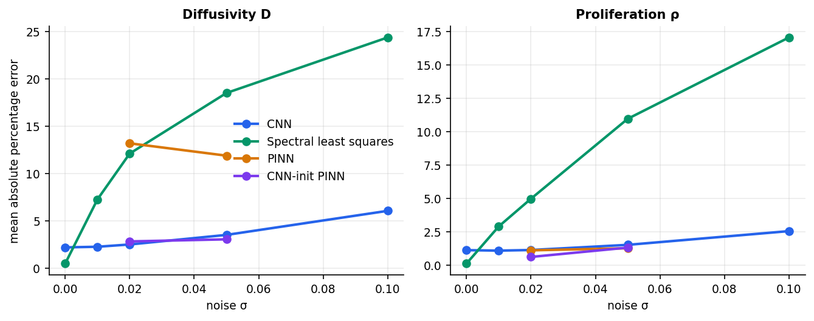
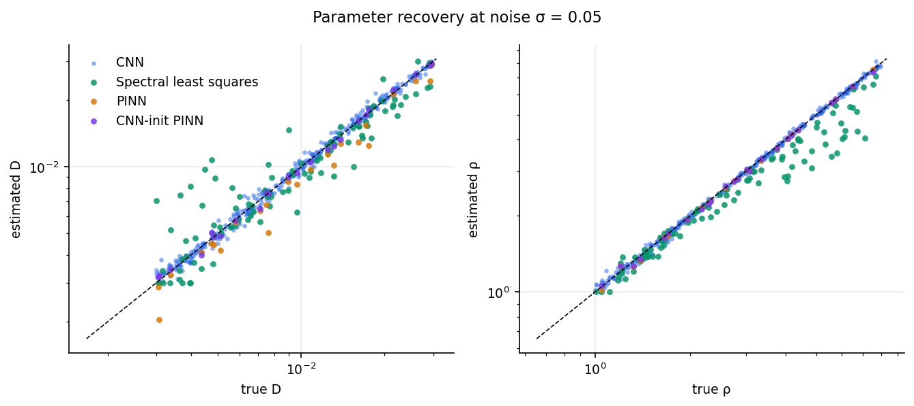
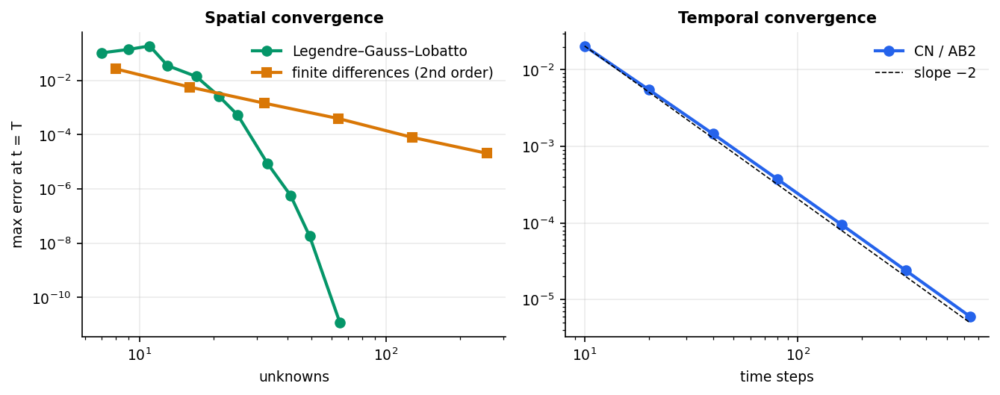

# TumorPINN Lab

[](https://github.com/mozhgantaghavi/tumor-growth-pinn/actions/workflows/ci.yml)
[](https://mozhgantaghavi.github.io/tumor-growth-pinn/)
[](LICENSE)


**Inferring tumour-growth parameters with Legendre spectral solvers, convolutional networks and physics-informed
neural networks (PINNs).**

**Interactive dashboard: <https://mozhgantaghavi.github.io/tumor-growth-pinn/>**

**Keywords:** physics-informed neural networks, PINN, convolutional neural networks, Legendre spectral methods,
reaction-diffusion, Fisher-KPP, Gompertz growth, tumour growth modelling, inverse problems, parameter estimation,
biomedical AI, computational oncology, scientific machine learning, PyTorch, GPU.



## What this project does

Reaction-diffusion models such as Fisher-KPP describe how a tumour invades surrounding tissue,

$$u_t = D\,u_{xx} + \rho\,u\,(1-u),\qquad u_x(0,t)=u_x(L,t)=0,$$

where *D* is the cell diffusivity and *&rho;* the proliferation rate. Given noisy space-time observations of the tumour
density, the inverse problem is to recover *(D, &rho;)*. This repository studies that problem end to end:

1. **Ground truth** from a Legendre-Gauss-Lobatto (LGL) spectral collocation solver with no-flux walls. It is the
   radial ingredient of the Fourier-Legendre method of Taghavi and Shahrokhi-Dehkordi (see [Reference](#reference)),
   applied here to a time-dependent biomedical PDE.
2. **Four estimators** compared on the same noisy data: a CNN (amortised inference), classical spectral
   least squares, a PINN, and a PINN warm-started from the CNN.
3. **Real data**: growth-law inference on three public mouse tumour datasets (breast carcinoma, Lewis lung carcinoma and a drug-treated breast cohort, about 240 mice) with thousands of PINNs trained in one
   batched **GPU** run.
4. **An interactive dashboard** (GitHub Pages) with an in-browser spectral solver, an inference lab with a live
   cost landscape, the full benchmark, and the real-data results.

Everything runs on a single workstation; only the real-data module benefits from a GPU, and it falls back to CPU.

## Results

### Synthetic space-time benchmark (Fisher-KPP, known truth)

Mean absolute percentage error (MAPE) of the recovered parameters; every table scores all methods on the same test cases.

**Noise σ = 0.02** (first 24 test cases, identical for all methods)

| Method | MAPE D | MAPE ρ | median APE D | median APE ρ | R² (log D) | R² (log ρ) | time / case |
|---|---:|---:|---:|---:|---:|---:|---:|
| CNN (3-member ensemble) | 3.2% | 0.9% | 3.3% | 0.6% | 0.997 | 1.000 | 1.6 ms |
| Spectral least squares | 8.6% | 3.1% | 3.9% | 2.1% | 0.962 | 0.990 | 0.1 s |
| PINN | 13.2% | 1.1% | 8.8% | 0.9% | 0.919 | 0.999 | 213.3 s |
| CNN-init PINN | 2.8% | 0.6% | 1.5% | 0.5% | 0.997 | 1.000 | 70.1 s |

**Noise σ = 0.05** (first 24 test cases, identical for all methods)

| Method | MAPE D | MAPE ρ | median APE D | median APE ρ | R² (log D) | R² (log ρ) | time / case |
|---|---:|---:|---:|---:|---:|---:|---:|
| CNN (3-member ensemble) | 3.5% | 1.7% | 2.6% | 1.2% | 0.996 | 0.998 | 1.5 ms |
| Spectral least squares | 19.4% | 10.2% | 11.9% | 8.0% | 0.864 | 0.910 | 0.1 s |
| PINN | 11.9% | 1.3% | 9.0% | 0.7% | 0.937 | 0.999 | 215.6 s |
| CNN-init PINN | 3.0% | 1.3% | 2.7% | 0.9% | 0.997 | 0.999 | 70.0 s |

Tables for the remaining noise levels are in [`docs/assets/results.md`](docs/assets/results.md).




- **Clean data:** the classical spectral fit is best (0.5 % error on *D*, 0.1 % on *ρ*, 100 cases) because it uses the exact model.
- **Noisy data:** the classical fit degrades quickly (19.4 % on *D* at σ = 0.05); the CNN, trained on noisy simulations from the same prior, degrades slowly (3.5 %).
- **Speed:** 1.5 ms per case for the CNN, 0.1 s for the spectral fit, 213 s for a PINN (single CPU thread).
- **PINN alone** recovers *ρ* well (1.1 to 1.3 %) but not *D* (12 to 13 %): *D* multiplies a second derivative of a network fitted to noisy data.
- **CNN-init PINN** keeps the CNN's accuracy (2.8 % / 0.6 % at σ = 0.02), needs one third of the PINN's time, and also returns a PDE-consistent field reconstruction.
- The CNN is tied to its training prior; outside it the classical and PINN estimators are the safer choice.

### Numerical accuracy



The LGL discretisation reaches 1e-11 with 65 unknowns, where second-order finite differences still sit at 2e-5 with 256. The Crank-Nicolson / Adams-Bashforth stepper shows observed order 1.9 to 2.0.

### Real mouse tumours (three public datasets, GPU)

Median relative error when forecasting the last two volume measurements of each mouse from the earlier ones:

| Dataset | mice | volumes | law | PINN (GPU) | least squares | best by BIC |
|---|---:|---:|---|---:|---:|---:|
| Breast carcinoma (vehicle controls) | 57 | 535 | exponential | 19.3% | 30.8% | 19 |
| | | | logistic | 16.3% | 18.6% | 10 |
| | | | gompertz | 16.3% | 18.4% | 28 |
| Lewis lung carcinoma | 19 | 167 | exponential | 25.6% | 31.9% | 7 |
| | | | logistic | 15.9% | 13.7% | 5 |
| | | | gompertz | 14.4% | 13.4% | 7 |
| Breast carcinoma (drug-treated) | 166 | 1778 | exponential | 19.8% | 29.2% | 55 |
| | | | logistic | 15.9% | 17.7% | 21 |
| | | | gompertz | 13.8% | 16.7% | 90 |

- Growth laws with saturation (logistic, Gompertz) forecast better than the exponential law on all three datasets, and the Gompertz law is the best by BIC on the breast and drug-treated cohorts.
- The batched PINN beats classical least squares on the breast and drug-treated cohorts for every law. On the small lung dataset (19 mice) it is slightly worse for the logistic and Gompertz laws (15.9 % vs 13.7 %, 14.4 % vs 13.4 %).
- The PINN enforces the growth law softly through a residual penalty, so part of its advantage may come from that acting as regularisation; it is not an exact ODE solution.
- The drug-treated mice received sunitinib or axitinib, so those fits describe net kinetics under treatment.

**GPU.** All networks of a dataset are trained as one batched model: 2 736 networks in 130 s (breast), 912 in 43 s (lung) and 7 968 in 348 s (drug-treated) on a GeForce GTX 1080 Ti. For the breast batch one training iteration takes 28 ms on the GPU and 385 ms on the CPU, a 13.7× speed-up. The space-time benchmark above runs on CPU.

## Quick start

```bash
git clone https://github.com/mozhgantaghavi/tumor-growth-pinn
cd tumor-growth-pinn
pip install -e ".[dev,figures]"          # PyTorch: choose the CPU or CUDA build for your machine

python examples/quickstart.py            # simulate, add noise, recover (D, rho) in a second
python -m tumorpinn all                  # data, train, benchmark, convergence, real data, export
python -m http.server -d docs            # dashboard at http://localhost:8000
```

Individual stages are cached under `artifacts/` and can be run alone:
`python -m tumorpinn {data,train,benchmark,convergence,real,export}`. Edit `configs/default.toml` (or pass
`--config my.toml`) to change the problem, noise levels, network sizes or the device (`real.device = "auto" | "cuda" | "cpu"`).

## How it works

```mermaid
flowchart LR
    S[LGL spectral solver<br/>no-flux walls] --- C[Noisy cohort<br/>u&#40;x,t&#41; + noise]
    C --- CNN[CNN ensemble]
    C --- NLS[Spectral least squares]
    C --- P[PINN]
    CNN ---|warm start| W[CNN-init PINN]
    CNN & NLS & P & W --- B[Benchmark and JSON export]
    R[Real mouse tumour curves] --- G[Batched PINNs on GPU]
    G --- B
    B --- D[Dashboard on GitHub Pages]
```



| Method | Idea | Strength | Weakness |
|---|---|---|---|
| CNN | reads the 32&times;64 space-time image, regresses log-parameters; trained on 6 000 noisy simulations | milliseconds per case, robust to noise | tied to its training prior |
| Spectral least squares | trust-region fit with the spectral solver in the loop | most accurate on clean data | degrades quickly with noise |
| PINN | MLP *u&theta;(x,t)* with PDE residual; *D, &rho;* trainable | mesh-free, unbiased by a prior | slow; *D* is poorly determined from noisy second derivatives |
| CNN-init PINN | PINN initialised at the CNN estimate and fine-tuned gently | keeps CNN accuracy and returns a PDE-consistent field | needs both models |

### Numerics

- **Spatial**: LGL collocation, derivative matrix *D<sub>mk</sub> = L<sub>M</sub>(&xi;<sub>m</sub>) / (L<sub>M</sub>(&xi;<sub>k</sub>)(&xi;<sub>m</sub> &minus; &xi;<sub>k</sub>))*;
  no-flux conditions by eliminating the two boundary unknowns.
- **Temporal**: Crank-Nicolson for diffusion, Adams-Bashforth 2 for the reaction term; observed order 1.9&ndash;2.0.
- **Validation**: against a Radau reference at tight tolerance, plus spectral and temporal convergence studies.

### Real-data module

`src/tumorpinn/real_data.py` models each mouse volume curve with *d ln V / dt = g(ln V)* for exponential, logistic and
Gompertz laws. One small network per *(mouse, law, mode, restart)* is trained with a data term and the ODE residual at
random collocation times; all networks are stacked and trained together with batched matrix products. Restarts are
selected on the training objective only, and forecasts are scored on the last two withheld measurements.
Data: Mastri, Tracz and Ebos, Zenodo [10.5281/zenodo.3574531](https://doi.org/10.5281/zenodo.3574531) (CC BY 4.0), see
[`data/real/README.md`](data/real/README.md).

## Repository layout

```
configs/default.toml        every experiment setting (no magic numbers in code)
src/tumorpinn/
  spectral.py               LGL nodes, weights, differentiation and interpolation, Neumann operator
  models.py                 PDE registry (Fisher-KPP, Gompertz)
  solver.py                 batched CN/AB2 solver and Radau reference
  data.py                   priors, initial tumours, noise, cached splits
  cnn.py  nls.py  pinn.py   the three estimators
  benchmark.py  metrics.py  head-to-head evaluation
  convergence.py            spatial and temporal convergence studies
  real_data.py              GPU-batched growth-law PINNs on real mouse data
  export.py  cli.py         dashboard JSON export, command-line pipeline
tests/                      pytest suite and Node tests (JS solver parity with Python)
docs/                       GitHub Pages dashboard (plain HTML/JS, Plotly) and exported results
checkpoints/                trained CNN ensemble
data/real/                  real mouse tumour measurements (CC BY 4.0)
scripts/make_figures.py     static figures and tables for this README
```

## Reproducibility and testing

- All randomness is seeded from `configs/default.toml`; the dataset, checkpoints and every number above come from
  `python -m tumorpinn all`.
- `pytest` (35 tests): spectral operators, solver accuracy against Radau, mass conservation, temporal order,
  front speed with the Bramson correction, estimators, metrics, real-data loaders and the batched GPU-style PINN.
- `node --test "tests/js/*.test.mjs"`: the dashboard's JavaScript solver reproduces the Python trajectories to
  1e-9 and recovers parameters in the browser.
- CI runs lint, both test suites and the dashboard checks on every push.
- GPU results depend on the CUDA build and device; the CPU path is deterministic up to library versions.

## Limitations

- The space-time benchmark uses synthetic data: with known truth it measures accuracy, but it is not clinical evidence.
- Observations are one-dimensional with additive Gaussian noise; the CNN is trained for one PDE family and one
  parameter prior.
- The real data contain tumour volumes only, so they test the growth law and rate, not the diffusivity.
- The CNN and the space-time PINNs run on CPU; only the batched real-data module uses the GPU (`real.device` in the configuration).
- With only 19 mice the lung dataset gives wide uncertainty on any method comparison.

## Extending

Add a growth law in `src/tumorpinn/models.py` and `docs/js/solver.js`, then run
`python -m tumorpinn all --model <name>`. See [CONTRIBUTING.md](CONTRIBUTING.md). Natural next steps are
gene-expression-informed priors for *(D, &rho;)*, two-dimensional domains with a Fourier-Legendre discretisation, and
treatment terms in the reaction part.

## Reference

M. Taghavi and M. S. Shahrokhi-Dehkordi, *A Fourier-Legendre spectral method for approximating the minimizers of
&sigma;<sub>2,p</sub>-energy*, Quarterly of Applied Mathematics (2023),
[doi:10.1090/qam/1674](https://doi.org/10.1090/qam/1674).

## Citation

See [`CITATION.cff`](CITATION.cff). Released under the [MIT licence](LICENSE); the real dataset keeps its own
CC BY 4.0 licence.
